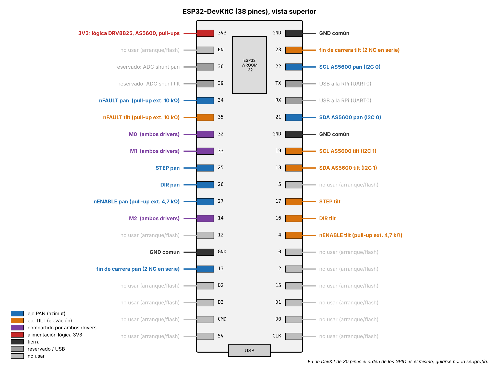
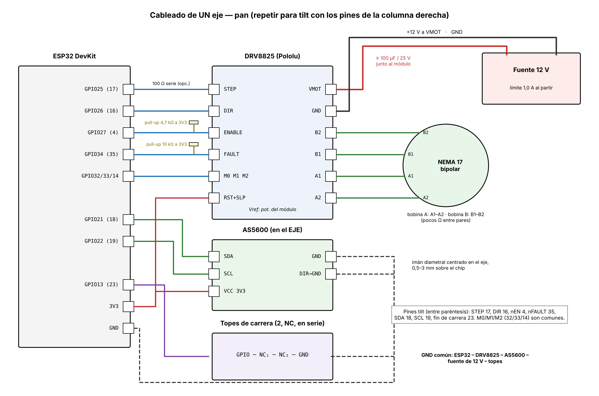

# Integración del lazo cerrado — conexiones y pruebas de laboratorio

IEE2913 Diseño Eléctrico (Capstone), Grupo 9 · Plataforma pan-tilt de seguimiento visual · 21 de octubre de 2026

## 0. Actualización 22-10: cableado real en el laboratorio

**El firmware y la RPi ya están ajustados a este cableado.** Las secciones 3 y 4 muestran la propuesta original (pines distintos, USB, nFAULT, topes y M0..M2) y quedan como referencia para la PCB.

| Señal | ESP32 (placa S/V/G) | Otro extremo |
|---|---|---|
| nENABLE / STEP / DIR pan (azimut) | GPIO13 / GPIO12 / GPIO14 (S) | DRV8825 pan |
| nENABLE / STEP / DIR tilt (elevación) | GPIO27 / GPIO26 / GPIO25 (S) | DRV8825 tilt |
| AS5600 pan SDA / SCL / VCC | GPIO21 (S) / GPIO22 (S) / V del GPIO23 | AS5600 pan (+ GND a una G) |
| AS5600 tilt SDA / SCL / VCC | GPIO18 (S) / GPIO19 (S) / V del GPIO5 | AS5600 tilt (+ GND a una G) |
| UART RX0 (GPIO3) | RX (S) | RPi pin 8 = GPIO14 (TXD) |
| UART TX0 (GPIO1) | TX (S) | RPi pin 10 = GPIO15 (RXD) |
| GND | G (fila del GPIO23) | RPi GND: **pin 6** (o 9, 14, 20, 25) |

Verificaciones antes de energizar:

1. **GND de la RPi.** En el header de la RPi, la fila exterior es 2-4-6-8-10-12. Contando desde el pin 2, la columna 3 es el pin 6 (GND), la 4 es el pin 8 (TXD), la 5 es el pin 10 (RXD) y la 6 es el pin 12 (GPIO18, **no es GND**). Confirmar con el comando `pinout` en la RPi.
2. **Tensión de la fila V.** Medir V–G de la placa de expansión: debe dar **3,3 V** (puente de la placa). Con 5 V, los pull-ups del AS5600 llevan SDA/SCL a 5 V, y el ESP32 no lo tolera.
3. **GND común del DRV8825.** El GND lógico de cada DRV8825 debe estar unido al G del ESP32. SLEEP y RESET van a 3V3.
4. **USB del ESP32 desconectado mientras corre el lazo.** RX0/TX0 es el mismo UART del chip USB. Alimentar el ESP32 por la placa de expansión. Para cargar firmware, desconectar el cable de RX0, o mover los dos cables a GPIO16 (RX2) / GPIO17 (TX2): el firmware escucha en ambos.
5. **Micropasos.**
   - M0..M2 no van al ESP32. Sueltos, el DRV8825 trabaja en paso completo (1,8°).
   - Para 1/16 (0,1125°, recomendado), llevar M2 a 3V3.
   - En la consola: `m 1` o `m 16`, según lo que tenga el driver. La prueba `t` lo verifica.

## 1. Qué se integró

Un único programa en la Raspberry Pi cierra el lazo de la cámara, y un firmware nuevo en el ESP32 cierra el lazo de posición de cada eje con los AS5600. Con eso queda implementado el diagrama de control del informe.

| Lado | Qué hace | Dónde |
|---|---|---|
| ESP32 | PI de `pid_t_2` por eje a 1 kHz (e = θ_ref − θ_med), pulsos STEP/DIR de ambos ejes, supervisión local (nFAULT, sensor, límites, topes de carrera, pérdida de pasos, watchdog), telemetría a 200 Hz y consola de diagnóstico | `esp_32/esp32_pan_tilt` |
| RPi | Detector de láser rojo (de `laser_op.py`), pose de la plataforma en el instante de exposición, dirección del objetivo en el mundo, predicción RLS y envío de θ_ref (y ω_ff opcional) | `raspberry_pi_5/rpi5_esqueleto` |

El firmware compila y enlaza contra Arduino-ESP32 2.0.17, el núcleo de `platform = espressif32@^6`. Las 25 pruebas sin hardware pasan, y el lazo cerrado se simuló completo en el PC. **Nada de esto se ha probado todavía en hardware real**: mañana es la primera vez.

## 2. Materiales para la sesión

- ESP32 DevKit (WROOM-32) y cable USB de datos a la RPi.
- 2 módulos DRV8825 (Pololu) con disipador, 2 NEMA 17, 2 AS5600 con su imán diametral.
- 4 finales de carrera con contacto NC (2 por eje).
- Fuente de laboratorio de 12 V, con límite de corriente.
- 2 electrolíticos de ≥ 100 µF / 25 V.
- Resistencias:
  - 2 × 4,7 kΩ para los pull-up de nENABLE;
  - 2 × 10 kΩ para los pull-up de nFAULT;
  - 4 × 100 Ω en serie con STEP y DIR (opcionales).
- Multímetro (Vref y resistencia de las bobinas) y, si hay, osciloscopio.

## 3. Mapa de pines del ESP32



El lado izquierdo de la placa lleva el eje pan, que conserva el mismo cableado de la prueba de concepto. El lado derecho lleva los sensores y el eje tilt. Todos los números salen de `include/config.h`.

### Tabla de conexiones, pin a pin

| Señal | ESP32 | Destino | Eje | Nota |
|---|---|---|---|---|
| STEP | GPIO25 | DRV8825 pan: STEP | pan | 100 Ω en serie (opcional) |
| DIR | GPIO26 | DRV8825 pan: DIR | pan | 100 Ω en serie (opcional) |
| nENABLE | GPIO27 | DRV8825 pan: ENABLE | pan | **pull-up 4,7 kΩ a 3V3 obligatorio** |
| nFAULT | GPIO34 | DRV8825 pan: FAULT | pan | **pull-up 10 kΩ a 3V3** (GPIO de sólo entrada) |
| fin de carrera | GPIO13 | tope NC 1 → tope NC 2 → GND | pan | los dos topes del eje en serie |
| SDA | GPIO21 | AS5600 pan: SDA | pan | bus I2C 0 |
| SCL | GPIO22 | AS5600 pan: SCL | pan | bus I2C 0 |
| STEP | GPIO17 | DRV8825 tilt: STEP | tilt | 100 Ω en serie (opcional) |
| DIR | GPIO16 | DRV8825 tilt: DIR | tilt | 100 Ω en serie (opcional) |
| nENABLE | GPIO4 | DRV8825 tilt: ENABLE | tilt | **pull-up 4,7 kΩ a 3V3 obligatorio** |
| nFAULT | GPIO35 | DRV8825 tilt: FAULT | tilt | **pull-up 10 kΩ a 3V3** (GPIO de sólo entrada) |
| fin de carrera | GPIO23 | tope NC 1 → tope NC 2 → GND | tilt | los dos topes del eje en serie |
| SDA | GPIO18 | AS5600 tilt: SDA | tilt | bus I2C 1 |
| SCL | GPIO19 | AS5600 tilt: SCL | tilt | bus I2C 1 |
| M0 | GPIO32 | M0 de **ambos** drivers | ambos | 1/16 = M2 M1 M0 = 1 0 0 |
| M1 | GPIO33 | M1 de **ambos** drivers | ambos | |
| M2 | GPIO14 | M2 de **ambos** drivers | ambos | |
| 3V3 | 3V3 | RESET y SLEEP de cada DRV8825, VCC de cada AS5600, pull-ups | — | RESET y SLEEP unidos |
| GND | GND | GND de drivers, AS5600, topes y fuente de 12 V | — | **tierra común** |
| USB | conector USB | puerto USB de la RPi | — | enlace y alimentación del ESP32 |

**Por qué estos pines:**
- Ninguno es de arranque (0, 2, 5, 12, 15) ni de la memoria flash (6–11).
- STEP y DIR están en GPIO menores que 32, porque la interrupción los escribe por registro.
- Cada AS5600 tiene su propio bus I2C. Como la dirección es fija (0x36), así no hace falta multiplexor, y un sensor caído no bloquea al otro.

## 4. Cableado de un eje



### Detalles que importan

- **nENABLE con pull-up.** GPIO4 tiene pull-down interno mientras el ESP32 arranca, y GPIO27 queda flotando. Sin los 4,7 kΩ a 3V3, el driver se habilita en el arranque y el motor puede dar tirones.
- **nFAULT con pull-up.** GPIO34 y GPIO35 no tienen pull-up interno. Si FAULT no se cablea, poner `USAR_PIN_FAULT = false` en `config.h`; si no, el ESP32 marca fallas falsas.
- **AS5600:**
  - se alimenta con **3V3**, no con 5 V;
  - el pin **DIR del módulo va a GND**, no se deja flotando (el sentido se corrige por software con `signoSensor`);
  - va en el **eje**, después de la correa, con el imán diametral centrado a 0,5–3 mm del chip.
  - Si el bus I2C falla con cables largos, agregar 4,7 kΩ de pull-up en SDA y SCL.
- **Topes de carrera NC en serie.**
  - En reposo el GPIO lee LOW. Si cualquiera de los dos topes se abre, o si se corta un cable, lee HIGH y el eje se detiene: es a prueba de fallas.
  - Qué tope se tocó lo indica el signo de θ.
  - El corte de ENABLE por hardware desde los topes (EA-5) queda para la PCB. Mañana la protección es sólo por software, con 3 ms de antirrebote más 1 ms de reacción.
- **Bobinas:** con el multímetro, cada par de cables con pocos ohmios (1–5 Ω) es una bobina. A1–A2 es la bobina A y B1–B2 la bobina B.

## 5. Alimentación y orden de energizado

1. Cablear todo **sin energía**.
2. **Vref** de cada DRV8825: con VMOT energizado y el motor **desconectado**, medir entre el cursor del potenciómetro y GND. Con resistencia de sensado R100, I_límite = 2·Vref.
   - Partir con Vref ≈ 0,4 V (0,8 A), o con el 70 % de la corriente nominal del motor si no hay disipador.
   - El torque requerido estimado es de 3,5 N·cm (pan) y 1,1 N·cm (tilt), con FS = 2: 7,0 y 2,1 N·cm. Basta con una fracción de la corriente nominal.
3. Apagar VMOT. Conectar los motores (**nunca** con VMOT energizado).
4. Conectar el USB del ESP32 a la RPi. Al encender, el firmware deja ambos drivers **deshabilitados**.
5. Encender VMOT a 12 V, con límite de 1,0 A.
6. Para apagar: **VMOT primero**, después el USB.

Los electrolíticos de ≥ 100 µF van a menos de 3 cm de cada módulo, con la polaridad correcta. Sin ellos, el pico al conectar la fuente puede destruir el DRV8825.

## 6. Puesta en marcha paso a paso

Consola: monitor de PlatformIO a **921 600 baudios**. `?` muestra la ayuda. Los ejes se escriben `pan`/`tilt` (o `0`/`1`).

| # | Paso | Comando | Resultado esperado |
|---|---|---|---|
| 1 | Sensores, sin VMOT | (al arrancar) | `AS5600 pan: OK ... status=0x20` en ambos ejes |
| 2 | Lectura a mano | `p` mientras se gira cada eje a mano | `med` cambia suave y continuo; `fin=ok` |
| 3 | Topes | `p` presionando cada tope | `fin=ACTIVO` en el eje correcto |
| 4 | Cero | centrar a mano y escribir `z` | imprime `ceroRaw`: copiarlo a `config.h` y recompilar |
| 5 | Límites | medir el recorrido libre | ajustar `limMinDeg`/`limMaxDeg` **antes** de los topes, en `config.h` y en `pt/parametros.py` |
| 6 | Signos, con VMOT | `e 1`, `t pan`, `t tilt` | pan va a la **derecha** y tilt hacia **arriba**; si no, invertir `signoMotor`. Si dice "signo CONTRARIO", invertir `signoSensor` |
| 7 | Lazo cerrado | `r pan 5`, `r pan 0`, `r tilt 3`, `r tilt 0` | cada eje va a la referencia y se queda; `x` corta todo |
| 8 | Modelo de pid_t_2 | ver la sección 7 | curva medida contra el modelo, y ζ (b) estimado |
| 9 | Lazo con cámara | `python3 main.py --fuente camara --enlace trama --puerto /dev/ttyUSB0 --duracion 30 --habilitar` | sigue el láser; revisar el CSV en `registros/` |

**Antes del paso 9:**
- El paso 9 es lo **único** que mueve los motores desde la RPi.
- Para observar sin mover, quitar `--habilitar`: el ESP32 queda deshabilitado.
- Para encontrar el puerto: `ls /dev/serial/by-id/`.
- Con el programa de la RPi corriendo, la consola del ESP32 queda bloqueada a propósito.

## 7. Prueba del modelo de pid_t_2

El firmware implementa la ley de `pid_t_2.pdf`: C(s) = Kp + Ki/s sobre e = θ_ref − θ_med, con salida ω_cmd. Le agrega lo que el hardware exige:
- saturación ω_max = 180°/s y límite de aceleración α_max = 300°/s² (las decisiones de diseño);
- anti-windup;
- dos agregados que sólo actúan con errores grandes.

| Agregado | Por qué |
|---|---|
| Tope de frenado del término P: \|P\| ≤ √(2·α_max·\|e\|) | Sin él, el límite de α trunca el frenado: tilt se pasaba 27,8° en un escalón de 60° |
| Integración sólo con \|e\| < 5° | En movimientos largos el integrador acumulaba y pan se pasaba hasta 7,7° |

En simulación, el peor sobrepaso baja a **2,3°** (escalones de 2 a 60°, ambos ejes, ambos juegos de ganancias). Con α sin límite (`a <eje> 0`) y escalones menores que 5°, la ley es **idéntica** a la lineal del PDF. Así se valida el modelo:

```
python3 herramientas/respuesta_escalon.py --puerto /dev/ttyUSB0 --eje pan --escalon 3 --habilitar
python3 herramientas/respuesta_escalon.py --puerto /dev/ttyUSB0 --eje pan --escalon 2 --alfa 0
python3 herramientas/respuesta_escalon.py --puerto /dev/ttyUSB0 --eje tilt --escalon 2 --alfa 0
```

La herramienta compara lo medido con el modelo lineal y con el modelo con límites, y busca el ζ que mejor reproduce la medición. Con eso queda **medido b = 2ζ√(Kt·M)**, que el PDF dejó supuesto, y el techo real de estabilidad Kp < b/M.

**Esto sirve para pan, no para tilt.** La resonancia de pan (~23 Hz) se ve en la captura (6 s, una muestra cada 2 ms), así que su ζ se puede estimar. La de tilt (~218 Hz, con la inercia estimada) no deja huella: el ζ ajustado de tilt no es confiable. De la prueba de tilt valen el tiempo de subida, el sobrepaso y el error final, que es justamente donde el techo Kp < b/M de tilt (55 a 273 1/s) queda lejos de las ganancias usadas.

**Ganancias de arranque:** pan Kp = 3, Ki = 2,25 y tilt Kp = 10, Ki = 25. Son menores que las del PDF (pan 5/6,25, tilt 20/100) porque, si ζ ≈ 0,02, el techo de pan es Kp < 5,7. Subirlas con `k pan 5 6.25` y `k tilt 20 100` sólo cuando el escalón no muestre oscilación a la frecuencia de resonancia (~22 Hz en pan).

## 8. Si algo falla

| Síntoma | Causa probable | Qué hacer |
|---|---|---|
| `SIN RESPUESTA O SIN IMAN` al arrancar | SDA/SCL invertidos, AS5600 a 5 V, imán lejos | revisar el cableado; `status` debe ser 0x20 |
| Falla `nFAULT` apenas se habilita | FAULT sin pull-up, o driver en sobrecorriente o UVLO | pull-up de 10 kΩ, o `USAR_PIN_FAULT = false`; revisar Vref y VMOT |
| `perdida de pasos` al primer movimiento | signo del motor o del sensor invertido | repetir `t <eje>` y corregir `signoMotor` o `signoSensor` |
| `FINAL DE CARRERA` sin tocar los topes | topes NO en vez de NC, o cable cortado | los topes van NC y en serie; si son NO, `FIN_CONTACTO_NC = false` |
| El eje oscila o zumba a ~20 Hz | Kp sobre el techo b/M | bajar Kp (`k`); medir ζ con la prueba de escalón |
| `ESP32: SIN TELEMETRÍA` en la RPi | puerto o baudios equivocados, o firmware de la PoC cargado | `--puerto /dev/serial/by-id/...`; cargar `esp32_pan_tilt` |
| El láser no se detecta | pico del plano V bajo 170 | subir `ganancias_color[0]` o bajar `exposicion_us` en `parametros.py`; revisar `pico` y `motivo` en el CSV |

## 9. Lo que sigue: monitoreo por HDMI o por servidor local

Para ver los resultados mientras se afina el control hay dos caminos. No son excluyentes: conviene que ambos lean del mismo "publicador" dentro de `main.py`.

| Criterio | Monitor HDMI en la RPi | Servidor local (dashboard web en la red del laboratorio) |
|---|---|---|
| Estado hoy | Ya existe: `main.py --ventana` (estilo `laser_op.py`) | Por construir |
| Qué muestra | La imagen con la cruz, el objetivo y el estado | Imagen (MJPEG) y gráficos en el tiempo de θ_ref, θ_med, error, estado y fallas |
| Quién lo ve | Una persona frente al banco | Cualquier notebook o celular en la red; varios a la vez |
| Requisitos | Monitor, teclado y sesión gráfica en la RPi | Red local: la del laboratorio, un cable Ethernet directo o la RPi como punto de acceso |
| Costo en el lazo | `imshow` + `waitKey` corren en el hilo del lazo (hoy cada 4 cuadros): agregan jitter | Codificar JPEG y servir en un hilo aparte, a 10–15 fps; el lazo no espera |
| Bloque MON del proyecto | No lo cubre: no hay registro ni gráficos | Lo cubre, y responde a la observación del 28/08 de definir la comunicación al dashboard |
| Con la RPi sin pantalla (SSH o servicio) | No funciona | Funciona |
| Riesgo | Bajo | La red de la universidad puede aislar equipos entre sí; se resuelve con Ethernet o con punto de acceso |

**Recomendación:**
- **Mañana, HDMI.** Ya está hecho y no depende de la red: sirve para afinar el control junto al banco.
- **En paralelo, un servidor web sólo en la red local.** Un hilo que sirva la imagen comprimida y la telemetría, de sólo lectura al principio. Es el bloque de Monitoreo y no requiere pantalla.
- **No exponerlo a internet.** Abrir un puerto o un túnel público pone a disposición de cualquiera un sistema que mueve motores. Si hace falta verlo desde fuera del laboratorio, usar una VPN privada como Tailscale, nunca un puerto abierto.
- **Antes de ambos:** mover la ventana HDMI a un hilo propio, para que mostrar imagen nunca retrase la consigna. Hay que medir el costo real de `imshow` y de la codificación JPEG en la RPi 5.
